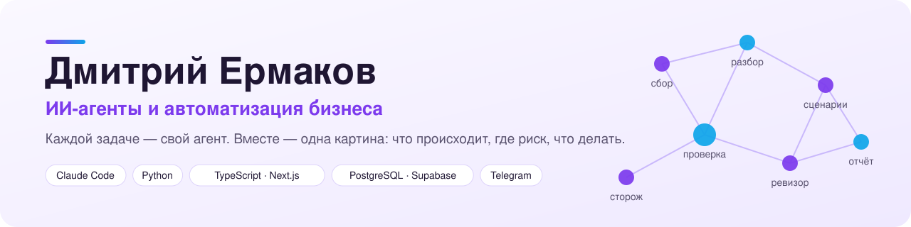
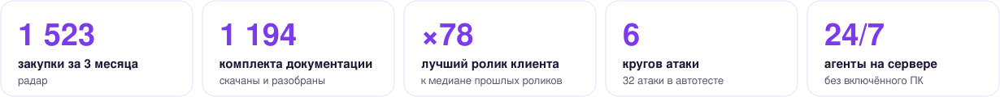
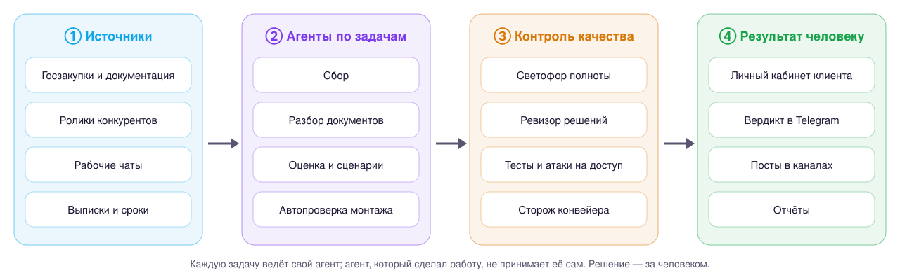
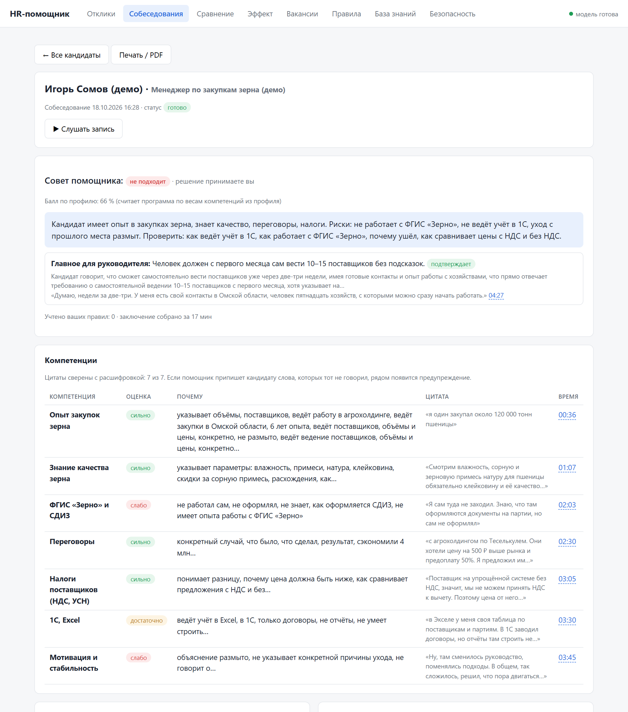
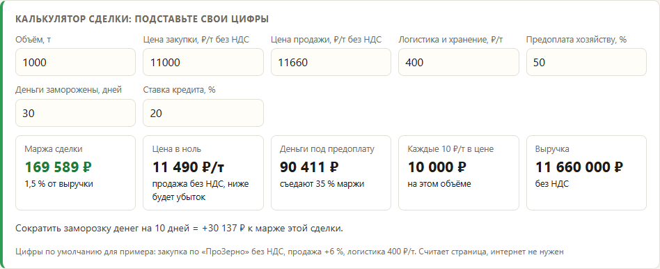
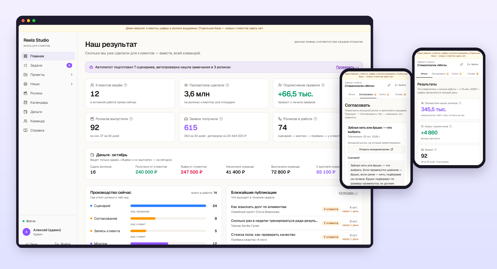
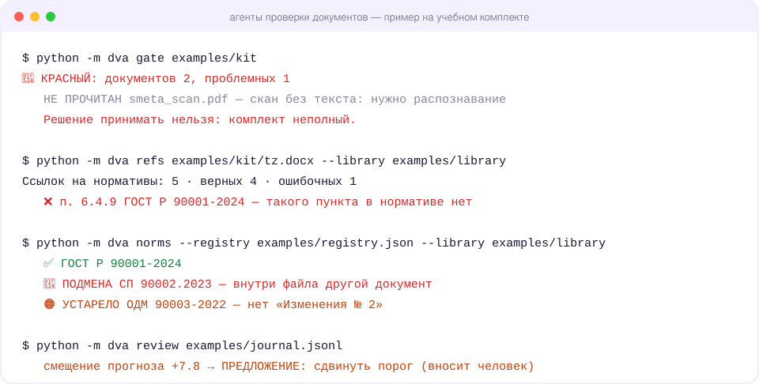

<picture>
  <source media="(prefers-color-scheme: dark)" srcset="assets/banner-dark.svg">
  
</picture>

<p align="center">
  <a href="https://t.me/official_konveyer"></a>
  <a href="https://github.com/Probudyvshysya/portfolio/actions/workflows/tests.yml"></a>
  <br>
  
  
  
  
  
  
  
  
  
</p>

<p align="center">
  <a href="#hr-помощник-разбор-собеседований-без-облака">HR-помощник</a> ·
  <a href="#помощник-закупщика-сводка-и-калькулятор-сделки">Закупщик</a> ·
  <a href="#бухгалтер-для-ип-на-усн-6-">Бухгалтер ИП</a> ·
  <a href="#reels-studio-ведение-smm-клиентов-с-личным-кабинетом">Reels Studio</a> ·
  <a href="#радар-госзакупок-и-проверка-документов">Радар закупок</a> ·
  <a href="#агент-поиска-заказов">Поиск заказов</a> ·
  <a href="#как-я-работаю-с-агентами">Как работаю</a>
</p>

**AI Automation Engineer** · Новосибирск · удалённо или гибрид · полная занятость в команде

Перевожу ручную работу отделов на ИИ-агентов и довожу до рабочего состояния: HR, закупки, бухгалтерия, документы, SMM.
Модель выбираю замером, а не по известности. Деньги и проценты считает код, модель только достаёт и объясняет.
Где данные чувствительные, модели работают на компьютере компании, без облака.

**Как читать этот репозиторий.** Код закрыт у трёх рабочих систем: радар закупок, Reels Studio и агент поиска
заказов; здесь их описание и цифры. Пять проектов открыты: код, тесты в CI и примеры на выдуманных данных тех же
форматов, вывод любого примера повторяется одной командой. Код открытых проектов перенесён из рабочих папок, поэтому
история коммитов здесь короткая. Сырые замеры HR-помощника лежат в [ZAMERY.md](agents/hr-interview-assistant/ZAMERY.md).

## Коротко

**Языковые модели в документах и речи**

| Проект | Для кого | Что делает | Результат | Код |
|---|---|---|---|---|
| [HR-помощник](agents/hr-interview-assistant) | HR, рекрутер | запись созвона → расшифровка → заключение по профилю должности с цитатами и таймкодами, разбор откликов | распознавание в 18 раз быстрее Whisper, 0 выдумок на шуме; локальные GigaAM и Qwen3 4B | **открыт**, 39 тестов |
| [Локальный поиск по документам](agents/local-rag-docs) | менеджер по продажам и закупкам | ответы по договорам и спецификациям со ссылкой на пункт, модель на своём ПК | 7 из 8 контрольных вопросов, 0 выдумок; bge-m3 и Qwen3 4B | **открыт**, 6 тестов |
| [Радар госзакупок](#радар-госзакупок-и-проверка-документов) | подрядчик, тендерный отдел | каждое утро находит закупки, читает документацию, выносит вердикт; для глубокого разбора комплектов подключаются агенты Claude | 1 523 закупки за 3 месяца, 57 % отсеяно автоматически с причиной | описание |
| [Reels Studio](reels-studio) | SMM-агентство | от ролика конкурента, который обогнал обычные просмотры автора, до заявки; кабинет клиента; разбор роликов и сценарии моделью | лучший ролик клиента ×78 к медиане; 6 кругов атаки на права, 18 обходов закрыто | описание и экраны |
| [Агент поиска заказов](agents/order-scout) | отдел продаж | обходит площадки, отбирает, Claude пишет черновик; человек жмёт «Отправить» | 2 прогона в день, 12-30 новых заказов за прогон, без кнопки человека ничего не уходит | описание |

**Точный расчёт без модели: там, где ошибка в цифре стоит денег**

| Проект | Для кого | Что делает | Результат | Код |
|---|---|---|---|---|
| [Помощник закупщика](agents/buyer-brief) | закупщик, отдел снабжения | утренняя сводка из открытых данных + калькулятор сделки: маржа, цена в ноль, стоимость денег под предоплату | 5 источников на одной странице, «что сделать сегодня» в рублях на партию; формулы в браузере сверяются с Python тестом | **открыт**, 29 тестов |
| [Бухгалтер ИП](agents/usn-bookkeeper) | ИП на УСН 6 % | выписка банка → доход / не доход с причиной → авансы и взносы по кварталам → сверка с ЕНС → сторож сроков в Telegram | дубли пересекающихся выгрузок сняты, 10 сроков в году со ссылкой на НК РФ, точка выгоды УСН против АУСН | **открыт**, 33 теста |
| [Проверка документов](agents/doc-verification) | тендерный отдел | пять проверок без модели: полнота чтения комплекта, ссылки на нормативы, подмена в библиотеке, разметка ТЗ, ревизор решений; их запускает субагент Claude Code | ядро радара закупок | **открыт**, 22 теста |

<picture>
  <source media="(prefers-color-scheme: dark)" srcset="assets/stats-dark.svg">
  
</picture>

## Как всё связано

<picture>
  <source media="(prefers-color-scheme: dark)" srcset="assets/scheme-dark.svg">
  
</picture>

---

## HR-помощник: разбор собеседований без облака

**Задача.** HR проводит до десяти собеседований в день и после каждого тратит, по моей оценке, 10-20 минут: переслушать, сверить
с требованиями, написать вывод. Облачная расшифровка не подходит: голос кандидата это персональные данные.
Поэтому распознавание и модель работают на компьютере HR, а в интернет уходят только обезличенные поисковые
вопросы для проверки фактов (каждый пишется в журнал, отключается одной настройкой).

**Решение.** Запись в две дорожки (HR и собеседник), расшифровка GigaAM, заключение Qwen3 4B строго по JSON-схеме:
оценка каждой компетенции с цитатой и таймкодом, красные флаги, противоречия, проверка фактов по ГОСТам из базы знаний,
черновики писем. Решение принимает HR, отказ помощник сам не отправляет. Поправка HR становится правилом для следующих разборов.

**Почему так, по замерам.** GigaAM против Whisper на настоящей записи рабочего созвона длиной 42 минуты (в репозитории её нет): 73 с против 1 325 с на процессоре,
0 выдуманных фраз на шуме против 9. Qwen3 4B против 30B на трёх демо-собеседованиях: выводы те же, но дословных цитат 21 из 21 против 14 из 21.
Проценты и флаги по деньгам считает код: модель однажды поставила флаг «ожидания выше вилки» при +16,7 % и пороге 20 %.



**Что получает HR.** К моменту, когда HR вернулся с созвона, расшифровка готова, а заключение собирается в фоне.
Не нужно переслушивать запись: в каждой оценке есть цитата и щелчок на нужную минуту. Кандидатов вакансии
можно сравнить на одном экране, а письма уже написаны.

**Стек:** Python, FastAPI, GigaAM, Silero VAD, sherpa-onnx, Ollama, bge-m3. [Код, замеры и тесты →](agents/hr-interview-assistant)

---

## Помощник закупщика: сводка и калькулятор сделки

**Задача.** Закупщик начинает день с десятка вкладок: курсы и ставка ЦБ, отраслевые новости, недельные цены, погода
на маршрутах доставки. При марже 1,5-2 % пропущенная новость о банкротстве контрагента или лишние десять
дней предоплаты съедают прибыль целой партии.

**Решение.** Одна страница каждое утро: светофор (цена, стоимость денег, контрагенты, сбыт), главные новости со строкой
«что это значит для нас», цены по регионам и список дел в рублях на партию. Например: «предоплата 10 млн ₽ на 30 дней
под 20 % стоит около 164 тыс. ₽, это 75-100 % маржи партии 1 000 т стоимостью около 11 млн ₽ без НДС, без проверки контрагента не отправлять». Калькулятор сделки
считает маржу, цену в ноль и цену заморозки денег. Ошибка любого источника не роняет страницу, старые цены помечаются.



**Что получает закупщик.** Утро начинается с готового списка дел в рублях, а не с десятка вкладок. Цену в ноль
и стоимость денег под предоплату видно до подписания сделки, а не после.

**Стек:** Python (только стандартная библиотека), JavaScript, 29 тестов без интернета. [Код и пример страницы →](agents/buyer-brief)

---

## Бухгалтер для ИП на УСН 6 %

**Задача.** ИП на УСН «Доходы» сам отделяет доход от переводов себе, кредитов и возвратов, считает авансы нарастающим
итогом с вычетом взносов и помнит десяток сроков в году. Ошибки в такой таблице находятся, когда налоговая уже начислила пени.

**Решение.** Одна команда по CSV-выписке: у каждого поступления причина «доход» или «не доход», налог по кварталам,
взносы с пропорцией за неполный год и потолком 1 %, сверка «уплачено на ЕНС против начислено по срокам», ближайшие
сроки с переносом на рабочий день. Сторож по cron пишет в Telegram за 14, 7, 3, 1 день и в день срока и не повторяется.
Ставки и сроки лежат в одном JSON со ссылкой на статью НК РФ, в коде нет ни одного числа из закона.

**Зачем сверка с ЕНС.** Частая ошибка ИП: платёж с назначением «страховые взносы» налоговая направляет в аванс по УСН.
Единый налоговый счёт раскладывает деньги по ближайшим срокам и назначение не читает, а взносы остаются неоплаченными.
Отчёт сам показывает, куда уйдёт излишек.

```text
НАЛОГ 6 % НАРАСТАЮЩИМ ИТОГОМ
  период                доход     налог 6 %   вычет взносов     доплатить
  1 квартал      355 000,00 ₽   21 300,00 ₽     14 347,50 ₽    6 952,50 ₽
  полугодие      900 000,00 ₽   54 000,00 ₽     28 695,00 ₽   18 352,50 ₽
  9 месяцев    1 305 000,00 ₽   78 300,00 ₽     43 042,50 ₽    9 952,50 ₽
  год          1 590 000,00 ₽   95 400,00 ₽     57 390,00 ₽    2 752,50 ₽
```

<sub>Выписка в примере выдумана.</sub>

**Что получает ИП.** Учёт без бухгалтера на абонементе: каждое поступление объяснено, налог посчитан по кварталам,
о сроке напоминание приходит за две недели, и деньги на ЕНС не уходят молча не туда.

**Стек:** Python (только стандартная библиотека), Telegram Bot API, cron, 33 теста. [Код и тесты →](agents/usn-bookkeeper)

---

## Reels Studio: ведение SMM-клиентов с личным кабинетом

**Задача.** Агентство ведёт пять клиентов одновременно, рутину по ним делает система. Каждый день найти темы,
которые уже сработали, написать сценарии, согласовать с клиентом, смонтировать, опубликовать и показать клиенту
результат в цифрах.

**Как работает.**
1. **Сбор.** Каждое утро агент собирает ролики конкурентов в нише клиента. Закрытый API Instagram отдаёт ошибку 429,
   поэтому сбор идёт через невидимый браузер: 22 аккаунта из 22 без ошибок (через API получался 1 из 22).
2. **Отбор.** Для каждого ролика считается **×N**: во сколько раз он обогнал обычный уровень своего автора (медиану).
   Залёт меряется нормой самого автора, поэтому большие аккаунты не перевешивают.
3. **Разбор.** ИИ разбирает залетевший ролик по речи и подписи: заход, раскадровка, почему сработал, идеи для каждого
   клиента ниши. Если в ролике нет ни речи, ни текста, разбор помечается как невозможный.
4. **Сценарий.** Два варианта под рубрику и голос клиента.
5. **Согласование в кабинете клиента.** Клиент читает сценарий, смотрит исходный ролик и нажимает «Согласовать»
   или «На доработку» с комментарием.
6. **Автопроверка монтажа** до того, как ролик увидит клиент: громкость −14 LUFS, длительность, вертикаль 1080×1920,
   сверка речи с утверждённым текстом через Whisper (на реальном ролике совпадение 98 %).
7. **Результат.** Просмотры, подписчики, заявки и договоры по каждому клиенту, графики по дням.

**Результат у реального клиента:** у дизайнера интерьера пятый ролик набрал 30 000 просмотров за сутки
при медиане десяти прошлых роликов 384, это **×78**, вовлечение 39,2 %. Ручной подбор тем по конкурентам занимал
около 4 часов в неделю на клиента, на пяти клиентах это около 80 часов в месяц; теперь сбор идёт каждое утро сам.



<p align="center"><sub>Рабочее место команды и личный кабинет клиента. Экраны сняты с копии на выдуманных клиентах</sub></p>

**Защита.** Каждая таблица под Row Level Security; клиент видит только свой проект через представления только для чтения;
монтажёр меняет только свою задачу и только поля монтажа; ролики в приватном хранилище, ссылка живёт 5 минут.
Шесть кругов атаки независимыми агентами (Claude, Qwen, DeepSeek) нашли и закрыли 18 обходов прав и утечек,
последний круг вернулся пустым; 32 атаки на права
повторяет автотест прямо в базе под каждой ролью.

**Стек:** Next.js 16, React 19, TypeScript, Supabase (Postgres, RLS, Auth, Storage), Python-воркеры.
Код закрыт: рабочая версия ведёт клиентов. [Экраны и модель безопасности →](reels-studio)

---

## Радар госзакупок и проверка документов

**Задача.** Каждый день выходят сотни закупок. По каждой надо прочитать комплект документов (техзадание, смету,
проект контракта) и понять, можно ли выполнить работу за эти деньги и нет ли барьера, из-за которого заявку отклонят.

**Как работает.** Сбор по 70 поисковым запросам от 100 тыс. ₽ → скачивание и распаковка всех файлов извещения
(zip, rar, 7z, doc, xls, PDF постранично) → оценка барьеров и плюсов по таблице баллов → вердикт «сами», «субподряд»,
«мимо» или «не проверено» → утренняя подборка в Telegram.

**Цифры с 12 августа по 8 ноября:** найдено 1 523 закупки, вердикт вынесен по 1 458, ещё 65 ждут разбора.
Документация скачана и разобрана у 1 194, остальные оценены по извещению: документов нет или они не скачались.

| Вердикт | Закупок | Что дальше |
|---|---|---|
| «мимо» | 867 (57 % найденных) | отсеяно автоматически, причина записана |
| «субподряд» | 401 | человек решает, отдавать ли часть работ |
| «сами» | 68 | человек готовит заявку |
| «не проверено» | 122 | документы сканами или без текста, читает человек |

По моей оценке, ручной разбор одного комплекта занимает около 2 часов, то есть 1 194 комплекта это примерно
2 400 часов работы специалиста.

**Мультиагентный разбор.** Двенадцать агентов параллельно построчно прочитали 31 комплект и вычеркнули 22 закупки
с причиной по каждой за 2 дня вместо примерно 8 рабочих дней вручную. Отдельный агент-ревизор перепроверяет выводы:
он дважды перевернул вердикт первого агента, поэтому теперь входит в каждый разбор.

**Каждый модуль вырос из конкретного инцидента:**

| Что случилось | Что теперь делает система |
|---|---|
| Готовая библиотека выдала **712 символов вместо 30 262**: текст был набран таблицей, ошибок в логах не было | свои парсеры Word с таблицами и сносками; полнота чтения проверяется на эталонных документах |
| Вывод «барьеров нет» сделан по половине комплекта: PDF читался до 25-й страницы | **светофор полноты** считает то, что *не* прочитано; при красном решение не принимается |
| Сбор **молча стоял пять суток**: расписание отрабатывало, логи писались, данных не было | **сторож конвейера** отличает «данных нет» от «конвейер сломан» |
| Площадка после 250 запросов в час отдаёт заглушку с кодом 200, и сбор «исправен», но находит 0 | заглушка распознаётся, приходит сообщение о блокировке |
| Глубину снижения цены на торгах узнавали после подачи | **журнал решений**: прогноз до подачи, факт после; ревизор раз в месяц ищет смещение |

**Открытый код:** [agents/doc-verification](agents/doc-verification), вычищенное ядро проверки документов, 22 теста.

<picture>
  <source media="(prefers-color-scheme: dark)" srcset="assets/terminal-dark.svg">
  
</picture>

---

## Локальный поиск по документам

Менеджер спрашивает обычными словами, модель отвечает за секунды со ссылкой на пункт договора.
Работает на компьютере компании через Ollama (bge-m3 + qwen3:4b), на видеокарте GTX 1650. На восьми контрольных
вопросах: 7 правильных ответов, 0 выдуманных. Нашла заложенное в тестовый комплект расхождение показателей качества
со спецификацией, хотя в документе лаборатории написано «соответствует». [Код и все ответы модели →](agents/local-rag-docs)

---

## Агент поиска заказов

Дважды в день сервер обходит площадки с заказами, правила кодом отсекают неподходящие, Claude разбирает подходящие
и пишет черновик отклика. В Telegram приходит карточка с кнопками «Отправить», «Поправить», «Пропустить»; после нажатия
скрипт сам заполняет форму в браузере и проверяет итог по странице заказа. Каждая ошибка сначала становится строкой
в файле уроков, потом правкой кода. [Схема и файл уроков →](agents/order-scout)

---

## Инфраструктура

Свой Linux-сервер, где агенты работают круглосуточно без включённого компьютера: службы systemd, задачи по cron,
пульты в Telegram с кнопками. Вход только по ключу, без пароля и root; файрвол и fail2ban; токены в файлах окружения
и не печатаются в журналы. Автопостинг канала через GitHub Actions: 40 постов без ручного участия, пост длиннее лимита
останавливает публикацию, а не обрезается.

---

## Как я работаю с агентами

- **Каждой задаче свой агент с понятной ролью:** исполнитель, проверяющий, ревизор, атакующий. Агент, который сделал
  работу, не принимает её сам.
- **Что делаю сам, а что агенты.** Архитектуру, требования, критерии приёмки и замеры делаю сам. Код и тесты пишет
  Claude Code под моим ревью, принимаю по тестам и прогону на данных. Любой файл этого репозитория разберу и объясню.
- **Модель выбираю замером на своих данных:** GigaAM против Whisper, 4B против 30B. Побеждает не известность, а цифры.
- **Во внешние модели уходят только открытые или обезличенные данные.** Чувствительное обрабатывают локальные модели.
- **Арифметику отдаю коду.** Модель достаёт числа и объясняет, программа считает.
- **Безопасность проверяю атакой.** Независимые агенты получают учётки каждой роли и задачу выкачать чужие данные;
  круг повторяется, пока не вернётся пустым.
- **Каждая найденная ошибка становится тестом** и строкой в журнале, чтобы не повторилась.
- **Факты сверяю по документу:** агент, который не дочитал, обязан об этом сказать.

**Инструменты:** Claude Code (агенты, навыки, хуки), Python, FastAPI, Ollama, GigaAM, TypeScript, Next.js,
PostgreSQL / Supabase, Playwright, ffmpeg, GitHub Actions, Linux (systemd, cron).

---

<p align="center">
  <b>Дмитрий Ермаков</b> · <a href="https://t.me/official_konveyer">Telegram @official_konveyer</a>
</p>
