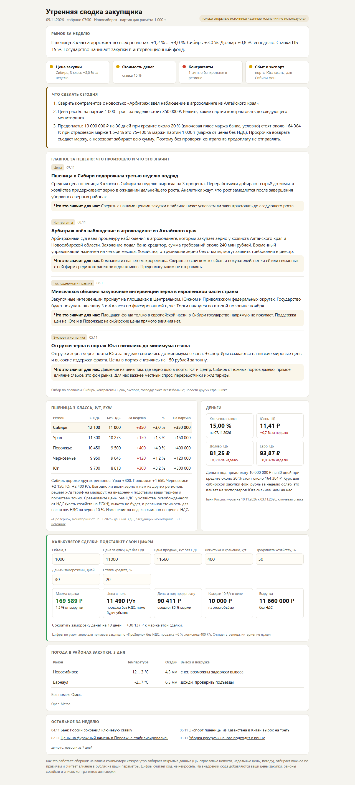
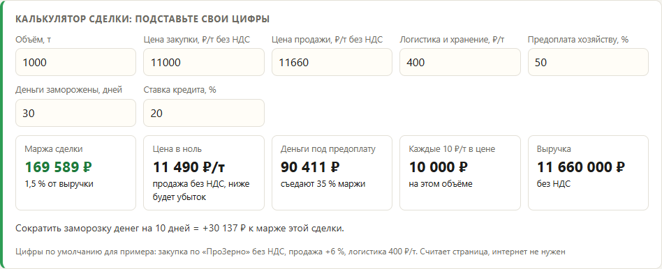
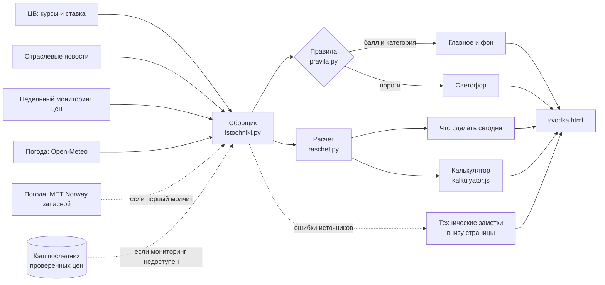

# Помощник закупщика: утренняя сводка и калькулятор сделки

Каждое утро собирает закупщику одну страницу: что изменилось на рынке за неделю, что это значит для закупки, что сделать сегодня и во что обходится сделка в рублях. Источники только открытые, суммы считает код, калькулятор работает без интернета.

| Роль | Стек | Цифры | Тесты |
|---|---|---|---|
| постановка задачи, правила отбора, код, тесты | Python 3.11+ (только стандартная библиотека), HTML, JavaScript | 5 источников, 6 категорий новостей, светофор из 4 ламп, калькулятор из 7 полей | 29, без интернета, [CI](../../.github/workflows/tests.yml) |

## Задача

Закупщик начинает день с десятка вкладок: курсы и ставка ЦБ, отраслевые новости, цены поставщиков, погода на маршрутах доставки. Каждую новость он сам переводит в вопрос «а нам что с этого». При марже в 1,5-2 % пропущенная новость о банкротстве контрагента или лишние десять дней предоплаты съедают прибыль целой партии.

Нужно было свести всё на одну страницу и сразу перевести в рубли на партию.

**Отрасль задаётся настройками.** Источники, категории новостей с весами, регионы и параметры сделки лежат в настройках и правилах, а не в логике. В примере подключён рынок зерна: недельный мониторинг цен и отраслевая лента. Калькулятор сделки, светофор, расчёт стоимости денег под предоплату и сверка контрагентов от отрасли не зависят.

## Решение



Страница открывается с лампами светофора и короткого списка дел. Так выглядит этот блок в примере:

```text
Что сделать сегодня
1. Сверить контрагентов с новостью: «Арбитраж ввёл наблюдение в агрохолдинге из Алтайского края».
2. Цена растёт: на партии 1 000 т рост за неделю стоит 350 000 ₽. Решить, какие партии
   контрактовать до следующего мониторинга.
3. Предоплаты: 10 000 000 ₽ на 30 дней при кредите около 20 % стоят около 164 384 ₽:
   при отраслевой марже 1,5–2 % это 75–100 % маржи партии 1 000 т. Без проверки
   контрагента предоплату не отправлять.
```

Что на странице:

- **Рынок за неделю.** Одна фраза: куда идёт цена по регионам, доллар, ставка ЦБ.
- **Светофор.** Цена закупки (жёлтый от +1 % за неделю, красный от +3 %), стоимость денег (жёлтый от ставки 12 %), контрагенты (красный, если в регионе есть новость о банкротстве), сбыт и экспорт.
- **Главное за неделю.** До пяти новостей с кратким пересказом и строкой «что это значит для нас». Например, интервенции в европейской части: «в Сибири государство напрямую не покупает, на сибирские цены прямого влияния нет».
- **Цены по регионам** (в примере пшеница 3 класса) с НДС и без, изменение за неделю и сколько это стоит на партию.
- **Калькулятор сделки.** Объём, цены закупки и продажи, логистика, доля предоплаты, срок, ставка кредита. На выходе маржа, цена в ноль, стоимость денег под предоплату и сколько даст сокращение заморозки денег на 10 дней.



- **Погода на 3 дня** в районах закупки: где снег и возможны задержки вывоза, где дожди и надо проверить подъезды.

## Схема



## Почему так

**Деньги и проценты считает код, а не нейросеть.** Модель может ошибиться в арифметике и сделает это уверенно, а закупщик по этим цифрам решает, отправлять ли 10 млн ₽ предоплаты. Поэтому все суммы считает `raschet.py`. Калькулятор в браузере повторяет те же формулы на JavaScript, и тест прогоняет оба варианта на общих примерах из [examples/sdelki.json](examples/sdelki.json): если формулы разойдутся хоть на копейку, тест упадёт.

**Новости отбирают правила с весами.** У каждой категории свой вес: контрагенты, цены, экспорт, господдержка. Сибирь в заголовке добавляет баллы, новости других стран их снимают. Правило можно прочитать, проверить на примере и поправить за минуту. Платную статью без текста сводка опускает вниз, а не пересказывает по заголовку.

**Два источника погоды.** Open-Meteo из России открывается не всегда, поэтому запасным стоит MET Norway: он отвечает без VPN. Если молчат оба, страница всё равно собирается, а в технических заметках появляется строка о том, что погоды нет.

**Кэш последних проверенных цен.** Мониторинг выходит раз в неделю, и его источник иногда недоступен. Тогда сводка берёт последние проверенные цены из кэша и прямо пишет на странице: «данным 10 дн., следующий мониторинг 06.11». Устаревшие цифры без пометки опаснее, чем их отсутствие.

**Ошибка источника не роняет сводку.** Каждый источник обёрнут отдельно. Недоступный ЦБ даёт строку «Данные ЦБ сегодня недоступны», а остальная страница собирается как обычно.

**Данные компании не используются.** В сводке только открытые источники. Параметры компании (партия, сумма предоплат, маржа банка к ставке, районы) лежат в одном файле [nastroyki.py](svodka/nastroyki.py), в примере они условные.

## Цифры

| Что | Значение |
|---|---|
| Источники | 5: курсы ЦБ, ключевая ставка, отраслевые новости, недельный мониторинг цен, погода с запасным источником |
| Отбор новостей | 6 категорий с весами, окно 7 дней, до 5 главных и до 10 в фоне |
| Светофор | 4 лампы с порогами в коде |
| Калькулятор | 7 полей ввода, 5 результатов, формулы совпадают с Python на 4 общих примерах |
| Сборка страницы из сохранённых ответов | меньше секунды |
| Зависимости | ни одной, только стандартная библиотека Python |

Пример из сводки: при отраслевой марже 1,5–2 % деньги под предоплату 10 млн ₽ на 30 дней под 20 % годовых съедают 75–100 % маржи партии в 1 000 т. Отсюда правило «без проверки контрагента предоплату не отправлять».

## Тесты

29 тестов, интернет не нужен: источники подменены сохранёнными ответами из [examples/fixtures](examples/fixtures).

- формулы сделки на общих примерах, совпадение Python и JavaScript (через Node.js);
- продажа по цене в ноль даёт нулевую маржу, без предоплаты деньги ничего не стоят;
- светофор на краях порогов: +0,99 % зелёный, +1 % жёлтый, +3 % красный; ставка 11,99 % и 12 %;
- банкротство в Сибири зажигает красный, такое же в другом регионе нет;
- разбор курсов ЦБ с номиналом 10, разбор мониторинга цен, мониторинг без Сибири отбрасывается;
- недоступный ЦБ, мониторинг или погода не роняют страницу и попадают в технические заметки;
- старые цены помечаются сроком давности.

```bash
python -m pytest -q
```

## Запуск

```bash
python -m svodka --offline -o examples/svodka-primer.html   # пример из сохранённых ответов, без интернета
python -m svodka                                            # живые источники, страница svodka.html
```

Готовый пример: [examples/svodka-primer.html](examples/svodka-primer.html). Для ежедневной работы сборщик ставится в планировщик на 7:30, страница открывается в браузере.

## Что дальше

Когда сводку ставят в конкретную компанию, в неё добавляются её собственные данные:

- свои цены закупки рядом с рыночными, чтобы видеть отставание в рублях на тонну;
- адреса поставщиков и складов вместо трёх условных городов, погода и логистика по ним;
- список контрагентов: новость о банкротстве сверяется с ним автоматически, а не глазами;
- свои тарифы перевозки, чтобы считать, выгодно ли везти товар из соседнего региона.

## Данные

Все заголовки, тексты статей, цены, курсы и погода в примере выдуманы. Реальные компании и люди не упоминаются. Ответы источников сохранены в формате, в котором их отдают настоящие сайты, поэтому разбор проверяется на правдоподобных данных.
