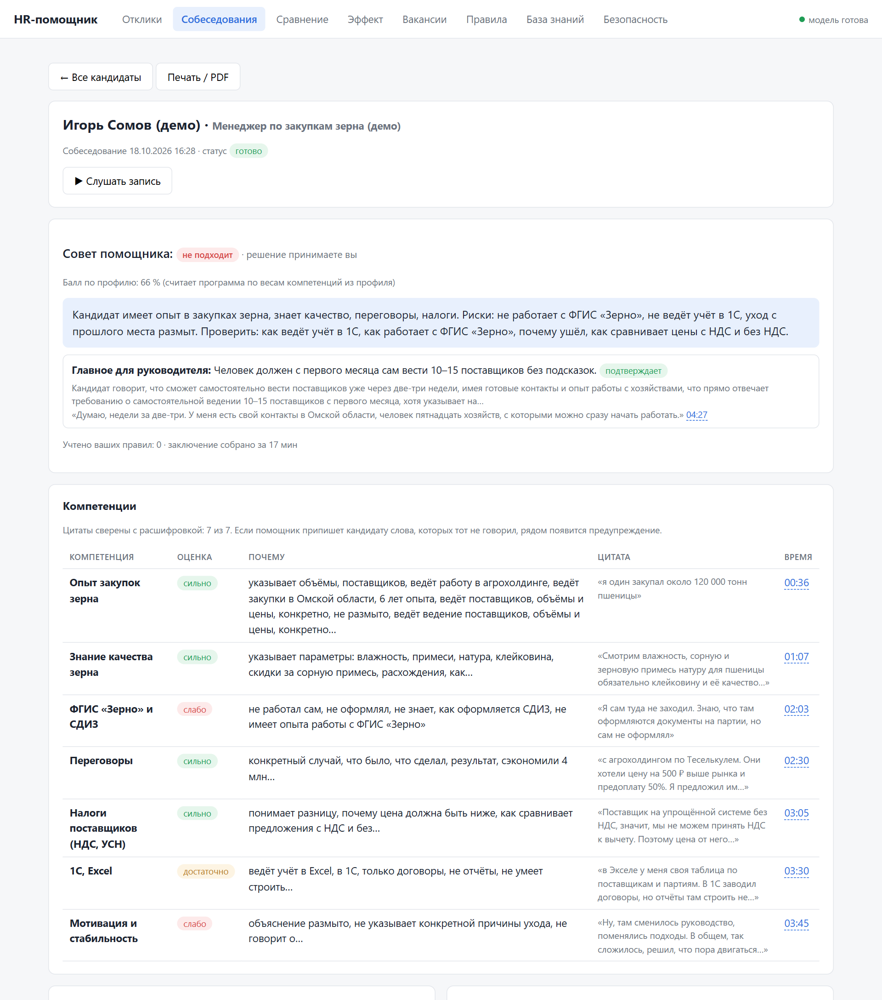
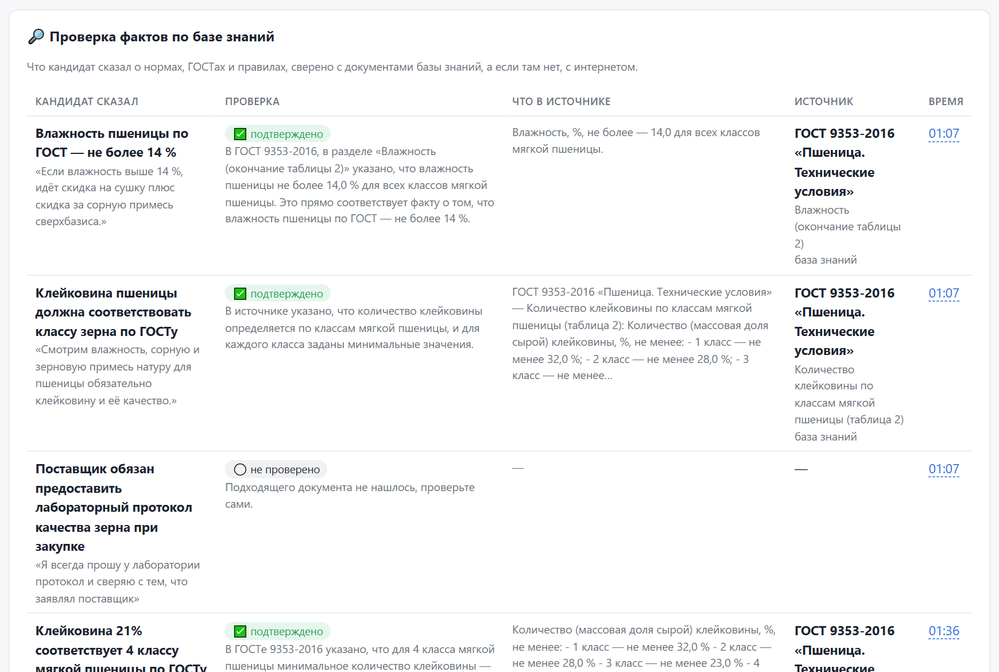
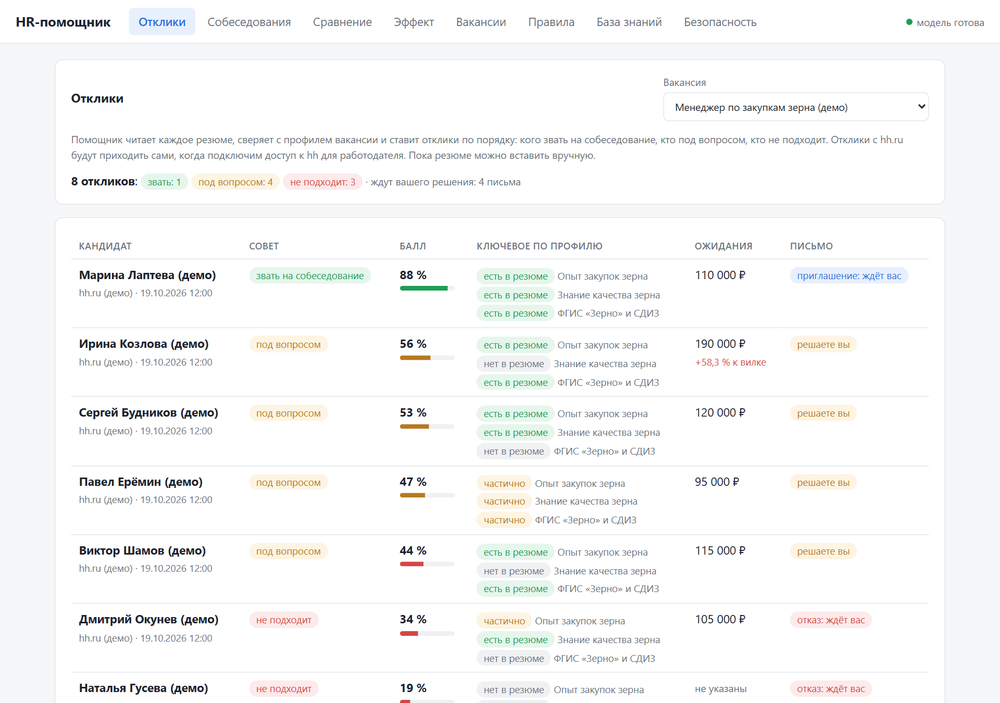
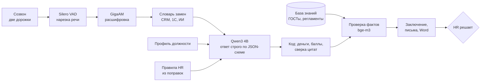
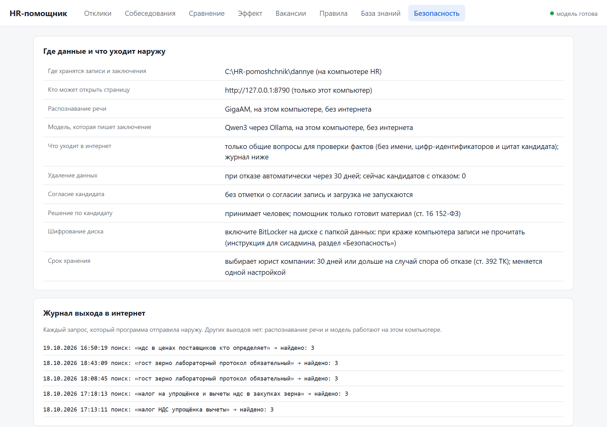

# HR-помощник: разбор собеседований без облака

Записывает созвон, расшифровывает, сверяет ответы с профилем должности и готовит HR заключение с цитатами и таймкодами.
Распознавание и модель работают на компьютере HR: голоса кандидатов никуда не уходят.

| Роль | Стек | Цифры | Тесты |
|---|---|---|---|
| вся система: запись, расшифровка, заключение, интерфейс | Python, FastAPI, GigaAM, Silero VAD, sherpa-onnx, Ollama (Qwen3 4B), bge-m3 | распознавание в 18 раз быстрее Whisper, 0 выдумок на шуме, цитаты дословно 21 из 21 | 39, без моделей, в CI |

## Задача

HR проводит до десяти собеседований в день. После каждого надо переслушать запись, вспомнить, что кандидат сказал
про опыт и деньги, сверить с требованиями руководителя и написать вывод. По моей оценке, это 10-20 минут на человека,
и к вечеру детали путаются. Облачные сервисы расшифровки не подходят: запись голоса кандидата это персональные данные,
отправлять их наружу компания не готова.

## Решение

HR отмечает согласие кандидата и нажимает «Начать запись». Пишутся две дорожки: микрофон HR и звук компьютера, поэтому
подходит любая программа для созвонов. После звонка запись разбирается в фоне:

1. **Расшифровка** с подписью, кто говорит.
2. **Оценка по профилю должности**: каждая компетенция получает «сильно / достаточно / слабо / нет данных», цитату
   кандидата и таймкод. Щелчок по таймкоду включает запись с этого места.
3. **Красные флаги и противоречия.** В демо кандидат сначала говорит «я один закупал 120 000 т», а через четыре минуты
   «это по отделу, нас трое». Помощник ставит рядом обе цитаты.
4. **Проверка фактов.** Если кандидат называет нормы ГОСТа, помощник сверяет их с базой знаний и ставит ссылку на пункт.
5. **Совет и черновики писем**: «приглашаем», «отказ», сводка руководителю, заключение в Word.

Решение принимает HR. Отказ помощник сам не отправляет никогда. Если HR не согласен с выводом, он пишет поправку,
она становится правилом и учитывается во всех следующих разборах.

Помощник не привязан к должности и отрасли. Требования задаёт профиль должности: HR заполняет его по короткому
чек-листу, вес каждой компетенции ставит сам. Факты кандидата сверяются с документами, которые компания положила
в базу знаний: стандарты, регламенты, должностные инструкции.

<p>
  
</p>
<p>
  
</p>
<p>
  
</p>
<p align="center"><sub>Заключение по кандидату · проверка фактов по ГОСТу · разбор откликов. Компания, вакансия и кандидаты выдуманы, голоса синтезированы</sub></p>

Кроме собеседований помощник разбирает резюме откликов (балл по профилю, кого звать, письмо), строит план
собеседования по компетенциям и показывает всех кандидатов вакансии на одном экране.

## Схема



## Почему так

**Модель распознавания выбрана замером, а не по известности.** GigaAM и Whisper large-v3-turbo прогнаны на одной
и той же настоящей записи рабочего созвона: 42 минуты, несколько собеседников, шум и перебивания. Этой записи
в репозитории нет, там чужие голоса; демо-собеседования из [demo/](demo) синтезированы отдельно.
Нарезка речи у обеих одинаковая.

| | GigaAM-v3 | Whisper large-v3-turbo |
|---|---|---|
| Время на 42 минуты записи, только процессор | **73 с** | 1 325 с |
| Доля от длины записи | **0,029** | 0,53 |
| Выдумал текст на тишине и шуме | **0 раз** | 9 раз («Продолжение следует...», «Спасибо.») |
| Пик памяти | 1,7 ГБ | не мерили |

Расшифровки разошлись в 14 местах. В 8 из них правильный вариант ясен по смыслу, и GigaAM прав в 7. Потом все 14
фрагментов прослушаны вручную: GigaAM заметно точнее по словам. Whisper в комплект не вошёл.

**Две дорожки вместо угадывания голосов.** Деление одной дорожки по голосам (sherpa-onnx, pyannote) работает и оставлено
запасным путём, но это самый медленный шаг и он ошибается на плохом звуке. При записи в две дорожки известно, кто говорит:
на демо-собеседовании расшифровка заняла 30 с против 81 с, все 40 реплик подписаны верно.

**Маленькая модель вместо большой, тоже по замеру.** На трёх демо-собеседованиях (7 компетенций у каждого, 21 цитата)
Qwen3 30B-A3B и 4B дали одинаковые выводы, ловушки и советы, но 30B пересказывает кандидата своими словами:
дословных цитат 14 из 21 против 21 из 21 у 4B. Для HR цитата важнее
красивого пересказа. 30B заняла 22,4 ГБ памяти, а 4B вместе с четырьмя разборами сразу и поиском
по базе знаний укладывается в 10 ГБ, поэтому хватает карты на 12-16 ГБ.

**Арифметику считает код, а не модель.** В первом прогоне модель поставила красный флаг «ожидания выше вилки» при +16,7 %
и пороге 20 %. Теперь модель только достаёт числа из разговора, процент и флаг считает программа, а флаги модели
про деньги код вычищает. Тот же принцип для балла по профилю: веса компетенций из профиля, сумма в коде.

**Длину ответа ограничивает схема, а не просьба.** Просьбу в промпте «не больше 15 слов» модель игнорировала,
а `maxLength` в JSON-схеме соблюдает всегда.

**Текст вне схемы ронял разбор.** На этой связке (Ollama 0.40, qwen3:4b-instruct-2507) модель сначала пишет
свободный разбор, Ollama кладёт его в поле `thinking`, и только потом идёт JSON по схеме. На этот текст схема не действует.
Дважды за замер рассуждение не закончилось (3,5 и 7 минут впустую), и один раз это уронило всё заключение по кандидату. Теперь короткие проходы отвечают сразу
JSON, у главного заключения потолок длины, а сорванный ответ пересобирается без рассуждения. На каждый случай есть тест.

**Каждая цитата сверяется с расшифровкой.** Если помощник припишет кандидату слова, которых тот не говорил,
рядом появится предупреждение. Проверка фактов говорит «не проверено», если подходящего документа нет, и не выдаёт
догадку за вердикт.

**Безопасность по умолчанию.** Сервер слушает только `127.0.0.1` и отклоняет запросы с чужих сайтов (Host и Origin).
Без отметки о согласии запись не запускается. После отказа данные кандидата удаляются через 30 дней, в журнале
остаются номер и даты без ФИО. Выход в интернет только для общих поисковых вопросов без имени и цитат, каждый запрос
пишется в журнал, а `HR_INTERNET=0` отключает его совсем.



## Цифры

Сырые таблицы замеров: железо, версии, все прогоны: [ZAMERY.md](ZAMERY.md).

| Что | Где | Время |
|---|---|---|
| Весь путь по записи на 38 минут: распознавание, заключение, проверка фактов | RTX 4090 | 0:59 |
| То же, три демо-собеседования по 5-7 минут | RTX 4090 / GTX 1650 | 0:48-1:15 / около 20 мин каждое |
| Распознавание трёх демо-записей | процессор сервера / ПК | 0:35 / 1:06 |
| Разбор резюме из отклика | RTX 4090 | 4 с |
| План собеседования по профилю | RTX 4090 | 12 с |
| Установка с нуля на чистый сервер вместе с моделями | | 4 мин 17 с |

Длина записи почти не влияет на время: основное уходит на модель (заключение и проверки фактов), а их число зависит
от того, что говорил кандидат. Поэтому короткое демо может идти дольше длинной записи. Пик памяти видеокарты 10 ГБ
при четырёх разборах сразу. На офисном компьютере без видеокарты, по расчёту от замера, расшифровка 40-минутного
собеседования займёт около 3 минут, а заключение соберётся в фоне за 20-40 минут, поэтому десять собеседований
разбираются к утру.

## Тесты

39 тестов, модели в них подменены фейками, поэтому они идут за секунды и в CI:

- очередь разборов: порядок, восстановление после перезапуска, ошибка одного кандидата не роняет остальных,
  пересборка не распознаёт запись заново;
- деньги и баллы считает код, флаги модели про деньги вычищаются;
- сорванный ответ модели не роняет заключение;
- цитаты сверяются с расшифровкой дословно, противоречие «лично или по отделу» ловится правилом;
- эхо из колонок вычищается из дорожки микрофона, словарь замен работает;
- сервер: без согласия нельзя, чужой сайт не достучится, путь `../` в имени файла не проходит;
- отказ кандидату никогда не уходит сам, данные отказников чистятся по сроку.

```bash
pip install -r requirements-dev.txt
python -m pytest -q
```

## Запуск

Полная установка для системного администратора: [USTANOVKA.md](USTANOVKA.md). Коротко:

```bash
pip install -r requirements-lock.txt
ollama pull qwen3:4b-instruct-2507-q4_K_M && ollama pull bge-m3
python PROVERKA.py          # проверка установки по пунктам
python -m hr.server         # страница на http://127.0.0.1:8790
```

Только расшифровка: `python rasshifrovka_po_rolyam.py --hr hr.wav --kandidat kandidat.wav -o sobes`.

## Что дальше

- Замер скорости на карте 12-16 ГБ: по пропускной способности памяти ожидаем 2-4 минуты на собеседование.
- Отклики напрямую из кабинета работодателя на hh.ru вместо ручной вставки резюме.
- Замер у HR в компании: неделя вручную, неделя с помощником, сравнение часов и совпадения советов с решениями.

## Данные

Компания, вакансия менеджера по закупкам, кандидаты и их резюме выдуманы. Собеседования написаны сценариями
([demo/](demo)) и озвучены синтезом речи, в них нарочно заложены ловушки: объём «лично или по отделу», незнание
обязательной для должности программы, размытая причина ухода, деньги чуть выше вилки. В базе знаний примера выдержки
из открытых ГОСТов на продукцию демо-компании и выдуманный регламент закупок. Для другой должности HR заполняет свой
профиль и кладёт свои документы, код не меняется. Настоящие записи, расшифровки и данные кандидатов в репозиторий
не входят.
