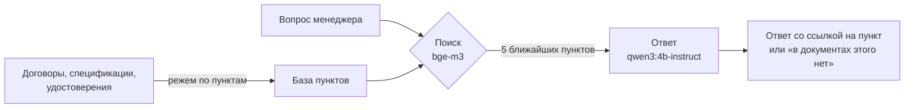

# Локальный ИИ-помощник по документам агротрейдера

**Задача.** У агротрейдера тонкая маржа, и деньги теряются на бумагах: не заметили, что протеин в партии
ниже договорного, пропустили скидку за влажность, перепутали допуск по весу, вагон простоял. Ответы на всё
это лежат в договорах, спецификациях и удостоверениях качества, но искать их приходится по папкам вручную.

**Решение.** Менеджер спрашивает обычными словами, ИИ отвечает за секунды со ссылкой на пункт договора.
Модель работает на компьютере компании: договоры и цены не уходят в интернет и к сторонним сервисам.

## Как это выглядит

```text
❓ Сходятся ли показатели в удостоверении качества № 318 со спецификацией?

   Сырой протеин: 41,2 % < 42,0 % — не соответствует [3][5]
   Влажность:     10,4 % > 10,0 % — не соответствует [3][5]
   Сырой жир, клетчатка, уреаза, примеси — соответствуют [3][5]
   Ответ: нет, не сходятся.

   [3] Удостоверение качества № 318 — п. 2 Результаты испытаний
   [5] Спецификация № 1 — п. 3 Базисные показатели качества
   ⏱ 11,5 с, на домашнем ПК, без интернета
```

В удостоверении лаборатория написала «партия соответствует». Модель сверила его со спецификацией
и нашла два расхождения. По договору это скидка к цене, а при влажности выше 12 % покупатель вправе
отказаться от партии.

## Откуда данные

Настоящие договоры трейдеров никто не покажет, это коммерческая тайна. Поэтому комплект собран по их образцу
и повторяет путь одной партии: элеватор, отгрузка, покупатель.

| Документ | Что в нём проверяется |
|---|---|
| [Договор поставки](docs/01-dogovor-postavki.md) соевого жмыха | базис FCA, допуск по весу ±5 %, скидки за протеин и влажность, штрафы |
| [Спецификация](docs/02-specifikaciya-1.md) на партию 1 000 т | цена, срок отгрузки, базисные показатели качества |
| [Удостоверение качества](docs/03-udostoverenie-kachestva.md) | фактический вес и анализы партии |
| [Регламент приёмки сои](docs/04-reglament-priemki-soi.md) на элеваторе | пробы, зачётная масса, сушка, хранение |

Показатели те же, по которым на практике принимают соевый жмых: протеин на сухое вещество, влажность,
жир, клетчатка, активность уреазы. Цифры и организации выдуманы. В документы специально заложены
ошибки, которые человек пропускает при беглой проверке.

## Как работает



1. Каждый документ режется по пунктам, поэтому ответ ведёт к конкретному пункту, а не к файлу целиком.
2. Модель `bge-m3` находит пять пунктов, ближайших к вопросу по смыслу, а не по точным словам.
3. `qwen3:4b-instruct` отвечает только по найденному. Если подходящего условия нет, она так и пишет.
4. Восемь контрольных вопросов с правильными ответами ([questions.json](questions.json)) проверяют систему
   после каждой правки.

Всё запускается через [Ollama](https://ollama.com) на обычной видеокарте GTX 1650 с 4 ГБ.

## Результат

| Метрика | Значение |
|---|---|
| Правильных ответов | **7 из 8** |
| Выдуманных ответов | **0** |
| Время ответа | медиана 2,7 с, максимум 11,5 с |
| Интернет | не нужен |

- **Нашла расхождение, которое пропустила лаборатория:** протеин и влажность не сходятся со спецификацией.
- **Посчитала скидку по договору:** протеин ниже базиса на 0,8 %, по 1,5 % за каждый процент, итого 1,2 % к цене.
- **Не придумала несуществующий штраф** за повреждение вагона, хотя рядом стоит пункт о простое вагонов.
- **Не справилась с вопросом сразу по трём документам** («есть ли недогруз и положен ли штраф»):
  ответила «в документах этого нет». Ошибка безопасная, но это предел простой схемы.

[Все ответы модели целиком →](results/eval-2026-10-16.md)

## Что это даст компании

| Кто | Сейчас | С помощником |
|---|---|---|
| Менеджер по продажам | ищет условия по покупателю в папках и переписке | спрашивает и получает пункт договора со ссылкой |
| Перед отгрузкой | удостоверение качества сверяют глазами | расхождения со спецификацией подсвечены до подписания |
| Приёмка на элеваторе | скидки за качество считают вручную | расчёт по договору с формулой |
| ВЭД | контракт и спецификацию сверяют на двух языках | та же сверка внутри компании, без отправки документов наружу |

**Путь до рабочей системы:** две недели на разбор, где в процессах теряются часы и деньги, затем пилот
на реальных документах одного отдела с замером «до и после». Для работы целого отдела нужен сервер
с видеокартой от 16 ГБ. Сверку цифр (вес против допуска, протеин против базиса) лучше передать коду:
модель находит и объясняет, программа считает без ошибок.

---

```bash
ollama pull bge-m3 && ollama pull qwen3:4b-instruct-2507-q4_K_M
python rag.py "Какой штраф за недогруз?"   # один вопрос
python rag.py --eval                        # 8 контрольных вопросов, отчёт в results/
python -m pytest -q                         # 6 тестов без Ollama
```
