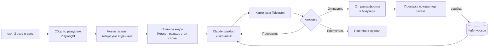

# Агент поиска заказов: человек в контуре

Дважды в день сам обходит площадки с заказами, отбирает подходящие, пишет черновик отклика и присылает карточку
в Telegram. Человек читает и нажимает «Отправить» или «Пропустить», дальше агент всё делает сам.

| Роль | Стек | Цифры | Тесты |
|---|---|---|---|
| вся система: сбор, отбор, черновик, отправка | Python, Playwright, Claude Code, Telegram Bot API, systemd, cron | 12-30 новых заказов за прогон, до карточки доходят 0-3, без кнопки человека ничего не уходит | код закрыт, описан кейс |

## Задача

Заказы на разработку и автоматизацию появляются на нескольких площадках в разное время и быстро закрываются:
на хороший заказ за пару часов приходят десятки откликов. Вручную обходить ленты утром и вечером долго, а большая
часть заказов не подходит по профилю или бюджету. При этом писать заказчику от имени человека без его ведома нельзя,
поэтому полностью автоматическая рассылка не подходит.

## Решение

1. **Сбор.** По расписанию сервер обходит разделы площадок, где есть наш профиль, и забирает новые заказы.
   Уже виденные отбрасываются.
2. **Отбор.** Правила кодом: бюджет, срок, раздел, стоп-слова. Порог бюджета зависит от того, сколько часов займёт
   работа, а не стоит одной цифрой.
3. **Разбор.** Claude читает заказ целиком: что на самом деле нужно, что можно показать из готовых проектов, какие
   вопросы задать. Пишет черновик отклика под этот заказ, а не шаблон.
4. **Карточка в Telegram.** Заказ, бюджет, почему подходит, черновик и кнопки «Отправить», «Поправить», «Пропустить».
   Поправку можно написать словами или голосом, агент перепишет черновик.
5. **Отправка.** После «Отправить» скрипт открывает форму отклика в браузере, заполняет и отправляет. Итог проверяется
   по странице заказа, а не по сообщению скрипта.
6. **Отчёт.** Сводка прогона: сколько нашлось, сколько отобрано и почему отсеяны остальные.

```text
🟢 Telegram-бот на Python с распознаванием чеков (MVP)
Бюджет: до 15 000 ₽ · срок 5 дней · раздел «Разработка»
Почему подходит: бот + OCR, похожее уже делали, укладывается в 3 часа работы
Вопросы заказчику: какие чеки (фото или PDF), куда складывать результат

Черновик:
Здравствуйте! Сделаю бота, который принимает фото чека, достаёт сумму, дату и магазин
и складывает в таблицу. ...

[Отправить]  [Поправить]  [Пропустить]
```

<sub>Пример карточки: заказ и текст выдуманы.</sub>

## Схема



## Почему так

**Человек в контуре.** Агент ищет, разбирает и пишет, но заказчику уходит только то, что человек прочитал и одобрил.
Это защищает репутацию: отклик, который заказчик примет за массовую рассылку, хуже, чем никакого.

**Файл уроков.** Каждая ошибка сначала становится строкой в файле уроков, потом правкой кода или задания.
Агент читает этот файл перед каждым разбором. Несколько настоящих строк оттуда:

| Что случилось | Правило |
|---|---|
| Человек четыре раза нажал «Отправить», но за неделю не ушёл ни один отклик: сервер умел только писать черновики | Выбор человека исполняется в течение часа. Если исполнить нечем, это поломка: сообщить и чинить |
| Проверка листала общую ленту, где разработка тонула среди рекламы и видео | Смотреть разделы, где наш профиль, разработку первой |
| Порог бюджета одной цифрой отсекал небольшие заказы на ботов и скрипты | Порог от трудоёмкости: небольшой заказ подходит, если это до 3 часов работы |
| В отклик попала ссылка на демо, которое открывалось на форме входа | В откликах только ссылки, которые открываются без входа и сразу показывают работу |
| Форму проверили на коротком тексте, а боевые отклики длинные, и все первые отправки упали | Пробный прогон на настоящем черновике, а не на заглушке |
| Скрипт записал удачные отправки в ошибки: после отправки площадка уводит на другую страницу | Итог проверять по странице заказа, а не по сообщению скрипта |

**Сервер, а не компьютер.** Агент работает на своём Linux-сервере как служба systemd и поднимается сам после перезагрузки.
Ноутбук может быть выключен. У бота один читатель обновлений: второй уводил бы сообщения себе.

**Секреты не в коде.** Токены лежат в файле окружения сервера и не печатаются в журналы. Доступ к серверу только по ключу.

## Цифры

| Что | Значение |
|---|---|
| Прогонов в день | 2 |
| Новых заказов за прогон | 12-30 (неделя 6-9 ноября) |
| Доходит до карточки | 0-3 за прогон |
| От нажатия «Отправить» до отклика | правило: не дольше часа, отправка с сервера с 9 ноября |

## Тесты

Код закрыт: в нём настройки площадок и рабочий профиль. Проверка устроена так же, как в открытых проектах этого
репозитория: каждая ошибка из файла уроков превращается в правило и проверку, а итог отправки сверяется с площадкой.

## Что дальше

- Считать, какие отклики дают ответ заказчика, и поднимать похожие заказы выше.
- Переносить удачные черновики в примеры для следующих разборов.

## Данные

Названия площадок, заказы, заказчики и тексты откликов не публикуются. Пример карточки выдуман.
