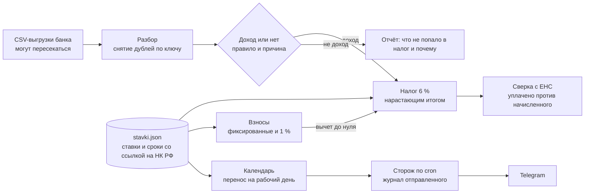

# Бухгалтер для ИП на УСН 6 %

Берёт CSV-выписку из банка и за секунду говорит ИП без работников, какой у него доход по УСН, сколько платить по каждому сроку и не потерялись ли деньги на едином налоговом счёте.

| Роль | Стек | Цифры | Тесты |
|---|---|---|---|
| сделал целиком: правила учёта, код, тесты | Python 3.11+, только стандартная библиотека, cron, Telegram Bot API | 29 операций разбираются за 0,2 с, 9 дублей из двух выгрузок сняты, 10 сроков в календаре со ссылкой на норму | 33 теста, [CI](../../.github/workflows/tests.yml) |

## Задача

ИП на УСН «Доходы» сам ведёт учёт, а бухгалтерия банка этого не делает или делает с ошибками. Каждый квартал нужно:

- отделить доход от остальных поступлений: перевод с собственной карты, овердрафт, возврат обеспечения заявки, возврат комиссии банка. Перепутаешь в одну сторону, заплатишь 6 % лишнего. В другую, получишь недоимку и пени;
- посчитать аванс нарастающим итогом и вычесть страховые взносы. ИП без работников уменьшает налог на взносы до нуля, и при небольшом доходе платить налог не нужно вовсе;
- не пропустить ни один срок: уведомления, авансы, фиксированные взносы, декларация, налог за год и 1 % с дохода свыше 300 000 ₽;
- проверить, что деньги на едином налоговом счёте (ЕНС) легли туда, куда ИП думает.

Вручную это таблица, калькулятор и календарь в телефоне. Ошибки в таких таблицах находятся, когда налоговая уже начислила пени.

## Решение

Одна команда на выдуманной выписке за 2026 год. Вторая выгрузка за сентябрь-ноябрь пересекается с первой, и программа это замечает:

```text
$ python -m usn examples/vypiska-demo.csv examples/vypiska-demo-sentyabr-noyabr.csv --segodnya 2026-11-09

ВЫПИСКА · 2026 год · файлов 2 · операций 29 · снято дублей 9

ДОХОД ПО УСН: 1 590 000,00 ₽ (12 поступлений)
НЕ ДОХОД (в налог не идёт):
  перевод собственных средств                     50 000,00 ₽
  кредит или заём                                 30 000,00 ₽
  возврат обеспечения заявки                      25 000,00 ₽
  возврат комиссии банка                             490,00 ₽

НАЛОГ 6 % НАРАСТАЮЩИМ ИТОГОМ
  период                доход     налог 6 %   вычет взносов     доплатить
  1 квартал      355 000,00 ₽   21 300,00 ₽     14 347,50 ₽    6 952,50 ₽
  полугодие      900 000,00 ₽   54 000,00 ₽     28 695,00 ₽   18 352,50 ₽
  9 месяцев    1 305 000,00 ₽   78 300,00 ₽     43 042,50 ₽    9 952,50 ₽
  год          1 590 000,00 ₽   95 400,00 ₽     57 390,00 ₽    2 752,50 ₽

ВЗНОСЫ ЗА СЕБЯ
  фиксированные с 01.01: 57 390,00 ₽
  1 % с дохода свыше порога: 12 900,00 ₽

ЕНС НА 09.11.2026
  уплачено из выписки:              78 300,00 ₽
  начислено по наступившим срокам:  35 257,50 ₽
  сверх сроков: 43 042,50 ₽. ЕНС спишет их в ближайшие начисления по сроку, назначение платежа не важно.
  Ближайшее начисление: фиксированные взносы за 2026 28.12.2026.
  Сверьте с кабинетом налогоплательщика: выписка видит платежи, ЕНС видит начисления.

БЛИЖАЙШИЕ СРОКИ
  28.12.2026  Фиксированные взносы за 2026 · 57 390,00 ₽
  26.04.2027  Декларация по УСН за 2026
  28.04.2027  Налог УСН за 2026 · 2 752,50 ₽
  01.07.2027  Взнос 1 % с дохода свыше порога за 2026 · 12 900,00 ₽

УСН 6 % ИЛИ АУСН 8 % при доходе 1 590 000,00 ₽
  УСН: налог и взносы 95 400,00 ₽ · АУСН: 130 159,00 ₽ · выгоднее УСН на 34 759,00 ₽
  Точка перелома: 734 728,00 ₽ в год. Ниже АУСН дешевле, выше УСН.
```

Декларация стоит на 26 апреля: 25 апреля 2027 года выпадает на воскресенье, и срок переносится на понедельник.

Сторож сроков запускается по cron раз в сутки и пишет в Telegram за 14, 7, 3, 1 день и в сам день срока:

```text
$ python -m usn storozh --god 2026 --test --segodnya 2026-12-21

Осталось 7 дней
Фиксированные взносы за 2026
Срок: 28.12.2026
Основание: п. 2 ст. 432 НК РФ: фиксированные взносы не позднее 28 декабря текущего года
```

## Схема



## Почему так

**Причина у каждого поступления.** Напротив каждого поступления программа пишет, почему оно попало в налог или нет. Человек проверяет решение за минуту и не пересчитывает всё заново. Правила лежат списком в [klassifikaciya.py](usn/klassifikaciya.py), первое совпавшее правило и есть причина. Тест следит, чтобы слово «кредитный» в назначении оплаты не превратило выручку в заём.

**Дубли снимаются по ключу, а не по сумме.** Банк отдаёт выписку кусками, и куски пересекаются. Две одинаковые оплаты в один день от одного заказчика бывают на самом деле, поэтому ключ собран из счёта, даты, номера платежа, суммы и направления. Оба случая закрыты тестами.

**Ни одного числа из закона в коде.** Ставки, потолки, сроки и ссылки на статьи лежат в одном файле [stavki.json](usn/stavki.json). Если года в файле нет, программа останавливается и не считает по прошлогодним ставкам.

**Сверка с ЕНС закрывает частую ошибку.** ИП платит на единый налоговый счёт с назначением «страховые взносы», а налоговая направляет деньги в аванс по УСН: ЕНС раскладывает поступления по ближайшим срокам и назначение платежа не читает. Взносы остаются неоплаченными, и это всплывает только в справке из кабинета налогоплательщика. Поэтому отчёт показывает, сколько ушло на ЕНС и сколько начислено по наступившим срокам, и прямо говорит, куда налоговая спишет излишек.

**Сторож хранит дату с годом.** Первая версия напоминаний была строкой в cron на каждую дату. В cron нет года, и напоминание про 28 октября с прошлогодней суммой сработало бы и через год. Теперь задача одна, она раз в сутки смотрит календарь, а журнал отправленного не даёт написать дважды. Если Telegram не ответил, напоминание не считается отправленным и уйдёт при следующем запуске.

**Сравнение с АУСН считает всю нагрузку, а не ставку.** 8 % выглядит дороже 6 %, но на АУСН нет взносов за себя. Программа считает «налог плюс взносы» в обоих режимах и находит доход, на котором они меняются местами: около 735 тыс. ₽ в год по ставкам 2026 года.

**Допущения названы прямо.** По умолчанию фиксированные взносы за год идут в вычет равными частями по кварталам
работы, флаг `--vznosy god` переносит их целиком в 4 квартал. Взнос 1 % за год платится до 1 июля следующего года,
поэтому по умолчанию он в вычет этого года не идёт, флаг `--odin-procent-v-etom-godu` его добавляет. Как распределять
вычет, решает ИП вместе с бухгалтером: программа показывает оба варианта, а не выбирает молча.

## Цифры

| Что | Значение |
|---|---|
| Разбор демо-выписки, 29 операций и 9 дублей | 0,2 с |
| Сроков в календаре на год | 10, у каждого ссылка на норму |
| Поводы «не доход» | 5: перевод себе, кредит, возврат обеспечения, возврат комиссии, возврат своего ошибочного платежа |
| Точка перелома УСН 6 % и АУСН 8 % в 2026 году | 734 728 ₽ дохода |
| Зависимости | ноль, только стандартная библиотека Python |

## Тесты

33 теста, каждый проверяет одно правило учёта:

- дубли из пересекающихся выгрузок снимаются, а две настоящие одинаковые оплаты остаются;
- перевод себе, овердрафт, возврат обеспечения и возврат комиссии не доход, у каждого своя причина;
- взносы уменьшают налог до нуля; аванс не бывает отрицательным, а переплата видна в годовом итоге;
- фиксированные взносы считаются пропорционально с середины месяца, 1 % не выше потолка;
- срок в воскресенье и в новогодние праздники переносится на рабочий день;
- сторож пишет за 7 дней, молчит за 8, не повторяется и повторяет, если отправка не прошла;
- точка перелома АУСН совпадает с расчётом на бумаге.

```bash
python -m pytest -q
```

## Запуск

```bash
python -m usn examples/vypiska-demo.csv                    # отчёт по выписке
python -m usn a.csv b.csv --moy-inn 000000000000           # несколько выгрузок и свой ИНН
python -m usn a.csv --nachalo 2026-04-01                   # УСН не с начала года: взносы пропорционально
python -m usn a.csv --vznosy god --odin-procent-v-etom-godu  # все взносы к вычету в 4 квартале
python -m usn storozh --test                               # что сторож отправил бы сегодня
```

Для Telegram сторожу нужны переменные окружения `TELEGRAM_BOT_TOKEN` и `TELEGRAM_CHAT_ID`. Без них он печатает напоминание в консоль. Токен в вывод не попадает.

## Что дальше

- Производственный календарь с переносами выходных из постановлений Правительства: сейчас учтены выходные и праздники из ст. 112 ТК РФ.
- Чтение справки о сальдо ЕНС из кабинета, чтобы сверять выписку с цифрами самой налоговой.
- Черновик уведомления об исчисленных суммах и декларации из тех же цифр.
- Книга учёта доходов (КУДиР) из разобранной выписки.

## Данные

Все организации, ИНН, номера счетов и суммы в [examples](examples) выдуманы, их собирает [make_demo.py](examples/make_demo.py). ИНН нулевые и заведомо недействительные. Настоящие выписки, декларации и реквизиты в репозиторий не попадают. Программа считает по закону, но решение о платеже остаётся за человеком: перед уплатой сверяйте цифры с кабинетом налогоплательщика.
